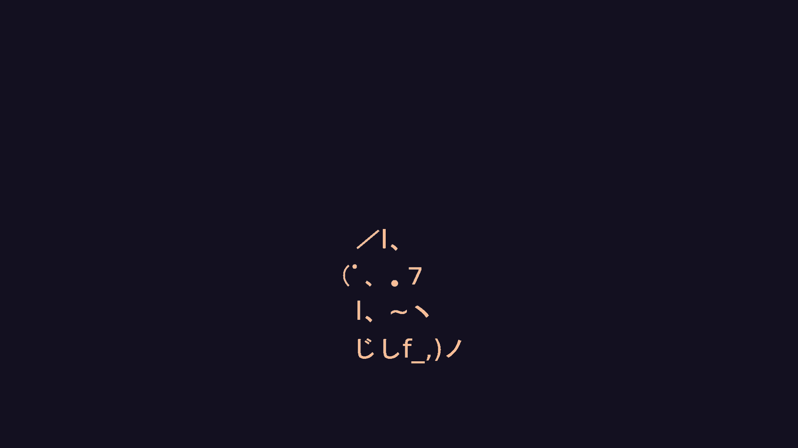

# glazewm-dotfiles

My Hyprland desktop (Catppuccin Mocha, vim-style tiling, waybar) rebuilt
for Windows 11 on [GlazeWM](https://github.com/glzr-io/glazewm),
[Zebar](https://github.com/glzr-io/zebar) and
[Flow Launcher](https://github.com/Flow-Launcher/Flow.Launcher). Same keys,
gaps, borders and bar, so switching between the two machines feels the
same.



## Install

In PowerShell (no git needed):

```powershell
irm https://raw.githubusercontent.com/DEFALT314/glazewm-dotfiles/main/bootstrap.ps1 | iex
```

Run the same line again to update. It downloads the repo to
`~\glazewm-dotfiles` and runs [`install.ps1`](install.ps1), which:

- installs GlazeWM, Zebar, Flow Launcher and JetBrainsMono Nerd Font with
  winget (GlazeWM goes to Program Files, so expect one UAC prompt)
- copies the configs into `~\.glzr\` (an existing config is kept once as
  `<name>.orig`)
- gives Windows Terminal the Catppuccin colors, font and transparency
  through a [fragment](terminal/catppuccin-mocha.json), without touching
  your `settings.json`
- downloads the Catppuccin Mocha theme for Flow Launcher and selects it
- sets the Bibata Modern Classic cursor and the wallpaper
- hides the Windows taskbar (the Zebar bar replaces it), which restarts
  Explorer once
- adds GlazeWM to autostart and starts it; GlazeWM starts Zebar

| File                             | Ends up in                                          |
| -------------------------------- | --------------------------------------------------- |
| `glazewm/config.yaml`            | `~\.glzr\glazewm\config.yaml`                       |
| `zebar/mocha-bar/`               | `~\.glzr\zebar\mocha-bar\`                          |
| `zebar/settings.json`            | `~\.glzr\zebar\settings.json`                       |
| `terminal/catppuccin-mocha.json` | `%LOCALAPPDATA%\Microsoft\Windows Terminal\Fragments\glazewm-dotfiles\` |
| `tapeta.png`                     | `Pictures\tapeta.png`                               |

## Monitors

Same as on Hyprland: workspace 1 on the laptop screen, 2-9 on the
external monitor. GlazeWM numbers monitors left to right (then top to
bottom), and the config assumes the monitor sits left of or above the
laptop (monitor = 0, laptop = 1). If the laptop is on the left at your
desk, swap the `bind_to_monitor` values in `glazewm/config.yaml`.

## Keys

The mod key is **left Alt** instead of Super. Windows reserves most
Win+key combos: Win+L always locks, so it can't mean "focus right". Only
left Alt is bound, so AltGr keeps typing ą ę ł ć.

| Hyprland                    | Here                          | Action                             |
| --------------------------- | ----------------------------- | ---------------------------------- |
| Super+Q                     | Alt+Q                         | Terminal (Windows Terminal)        |
| Super+E                     | Alt+E                         | Explorer                           |
| Super+R                     | Alt+R or Alt+Space            | Launcher (Flow Launcher)           |
| Super+C                     | Alt+C                         | Close window                       |
| Super+V                     | Alt+V                         | Toggle floating                    |
| Super+F / Super+Shift+F     | Alt+F / Alt+Shift+F           | Fullscreen / maximize              |
| Super+M                     | Alt+M                         | Quit GlazeWM                       |
| Super+H J K L, arrows       | Alt+H J K L, arrows           | Focus                              |
| Super+Shift+H J K L, arrows | Alt+Shift+H J K L, arrows     | Move window                        |
| Super+right mouse drag      | Alt+Ctrl+H J K L              | Resize                             |
| Super+1..0                  | Alt+1..0                      | Workspace                          |
| Super+Shift+1..0            | Alt+Shift+1..0                | Move window to workspace           |
| Super+Ctrl+Left/Right       | Alt+Ctrl+Left/Right           | Previous/next open workspace       |
| Super+T (commented out)     | Alt+T                         | Flip split direction               |
| Super+B                     | Alt+B                         | Bluetooth settings                 |
| Super+Escape                | Alt+Escape or Win+L           | Lock                               |
| Super+N                     | Win+N                         | Notifications                      |
| Super+Shift+S / Print       | Win+Shift+S / PrtSc           | Screenshot                         |
| Super+Shift+V               | Win+V                         | Clipboard history                  |
| Super+`                     | Win+`                         | Drop-down terminal (WT quake mode) |
| -                           | Alt+Shift+P                   | Pause GlazeWM's keys               |
| -                           | Alt+Shift+R                   | Reload `config.yaml`               |

## Manual

System settings the script leaves alone (some need admin or company approval):

| Hyprland                 | Windows                                                                 |
| ------------------------ | ----------------------------------------------------------------------- |
| hyprsunset 20:00-7:30    | Settings → Display → Night light, schedule 20:00-07:30                  |
| hypridle lock at 5 min   | Screen saver settings: wait 5 min, "On resume, display logon screen"    |
| hypridle suspend 30 min  | Settings → Power → Sleep after 30 minutes                               |
| `kb_options = caps:none` | PowerToys → Keyboard Manager → Caps Lock → Disable                      |
| `GDK_SCALE = 1.25`       | Settings → Display → Scale 125%                                         |

Win+` only works while Windows Terminal is running. To keep it ready, turn
on Settings → Startup → "Launch on machine startup" in Windows Terminal.

## Not carried over

- **Animations, blur, shadows, dim_inactive.** GlazeWM only does borders,
  rounded corners and hidden title bars. The terminal gets acrylic blur.
- **Dwindle.** New windows split in the current direction; flip it with
  Alt+T.
- **Moving windows with the mouse.** Title bars are hidden, so there's
  nothing to drag. [AltSnap](https://github.com/RamonUnch/AltSnap)
  (`winget install AltSnap.AltSnap`) brings back Alt+drag.
- **Special workspaces** (Spotify, Discord). The terminal one is WT's
  quake mode.
- **Touchpad gestures.** Windows' 3-finger swipe moves between its own
  virtual desktops, not GlazeWM workspaces.

## Troubleshooting

- **An app needs one of the Alt shortcuts** (e.g. Alt+F for a menu):
  Alt+Shift+P pauses GlazeWM until pressed again.
- **An app looks broken without its title bar:** set `hide_title_bar` to
  `false` in both blocks of `window_effects`, or add a window rule for it.
- **The bar is empty:** it loads the `zebar` JS library from esm.sh, so
  the first start needs internet (then it's cached for 7 days).
- **Suspend in the bar does nothing:** laptops with Modern Standby may
  refuse the call. Closing the lid or Start → Sleep still works.
- **Company policy** may override the wallpaper, power settings or block
  winget. In that case install the four apps by hand and run
  `install.ps1` again.
