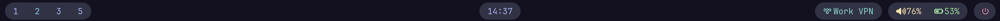
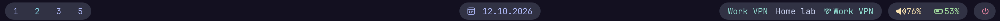
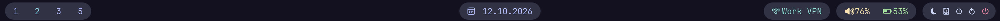

<div align="center">

# glazewm-dotfiles

A keyboard-driven tiling desktop for Windows 11, ported from my Hyprland
setup. GlazeWM, Zebar and Flow Launcher, themed in Catppuccin Mocha and
installed with one command.

[](https://github.com/DEFALT314/glazewm-dotfiles/actions/workflows/ci.yml)
[](LICENSE)




</div>

## Features

- **Tiling window manager.** [GlazeWM](https://github.com/glzr-io/glazewm)
  with vim-style keys, gaps, colored borders, rounded corners and no title
  bars.
- **Status bar.** A custom [Zebar](https://github.com/glzr-io/zebar) widget
  with workspaces, clock and date, a VPN switcher, volume, battery and a
  power menu.
- **Launcher.** [Flow Launcher](https://github.com/Flow-Launcher/Flow.Launcher)
  with the Catppuccin theme.
- **One theme everywhere.** Catppuccin Mocha in the bar, Windows Terminal and
  Flow Launcher, plus the Bibata cursor and JetBrainsMono Nerd Font.
- **Same muscle memory as Hyprland.** Same keys on a different modifier;
  everything Windows already does natively stays on its native shortcut.
- **One-line, re-runnable install.** No git needed; run it again to update.

## Requirements

- Windows 11 (borders and rounded corners use Windows 11 APIs)
- [winget](https://learn.microsoft.com/windows/package-manager/winget/),
  preinstalled on current Windows 11
- Rights to approve one UAC prompt, since GlazeWM installs to Program Files

## Installation

Open PowerShell and run:

```powershell
irm https://raw.githubusercontent.com/DEFALT314/glazewm-dotfiles/main/bootstrap.ps1 | iex
```

[`bootstrap.ps1`](bootstrap.ps1) downloads the repository to
`~\glazewm-dotfiles` and runs [`install.ps1`](install.ps1), which:

1. Installs GlazeWM, Zebar, Flow Launcher and JetBrainsMono Nerd Font with
   winget.
2. Copies the GlazeWM and Zebar configs to `~\.glzr\`. The first time a
   config already exists, it is moved to `~\.glzr\backup\`.
3. Gives every Windows Terminal profile the Catppuccin colors, font and
   transparency, and the tabs the Catppuccin theme. It merges
   [`terminal/catppuccin-mocha.json`](terminal/catppuccin-mocha.json) into
   your `settings.json` (backed up to `~\.glzr\backup\` first): the colors
   go to `profiles.defaults`, and profiles that set their own color scheme
   lose that override. Everything else in the file stays as it was.
4. Installs and selects the Catppuccin Mocha theme in Flow Launcher.
5. Sets the Bibata Modern Classic cursor and the wallpaper.
6. Turns on taskbar auto-hide (the bar replaces it). This restarts Explorer
   once.
7. Adds GlazeWM to autostart and starts it. GlazeWM then launches Zebar.

To install from a clone instead:

```powershell
git clone https://github.com/DEFALT314/glazewm-dotfiles
powershell -ExecutionPolicy Bypass -File glazewm-dotfiles\install.ps1
```

## Keybindings

The modifier is **left Alt**. Windows reserves most Win-key combinations
(Win+L always locks the screen), so Win can't serve as the modifier. Only
the left Alt is bound, which keeps AltGr free for typing characters such
as ą, ę and ł.

### Window manager

| Keys                            | Action                                    |
| ------------------------------- | ----------------------------------------- |
| `Alt` `H` `J` `K` `L` / arrows  | Focus left, down, up, right               |
| `Alt` `Shift` + direction       | Move window                               |
| `Alt` `Ctrl` `H` `J` `K` `L`    | Resize window                             |
| `Alt` `1`…`0`                   | Switch to workspace 1-10                  |
| `Alt` `Shift` `1`…`0`           | Move window to workspace and follow it    |
| `Alt` `Ctrl` `←` / `→`          | Previous / next open workspace            |
| `Alt` `C`                       | Close window                              |
| `Alt` `V`                       | Toggle floating                           |
| `Alt` `F`                       | Toggle fullscreen                         |
| `Alt` `Shift` `F`               | Toggle maximized                          |
| `Alt` `T`                       | Flip the split direction for new windows  |
| `Alt` `Shift` `P`               | Pause all GlazeWM keybindings             |
| `Alt` `Shift` `R`               | Reload the config                         |
| `Alt` `M`                       | Quit GlazeWM                              |

### Apps

| Keys                            | Action                                    |
| ------------------------------- | ----------------------------------------- |
| `Alt` `Q`                       | Windows Terminal                          |
| `Alt` `E`                       | File Explorer                             |
| `Alt` `R` or `Alt` `Space`      | Flow Launcher                             |
| `Alt` `B`                       | Bluetooth settings                        |
| `Alt` `Esc` or `Win` `L`        | Lock screen                               |

### Native Windows shortcuts

These match the Hyprland setup without any configuration:

| Keys                            | Action                                    |
| ------------------------------- | ----------------------------------------- |
| `Win` `Shift` `S` / `PrtSc`     | Screenshot                                |
| `Win` `V`                       | Clipboard history                         |
| `Win` `N`                       | Notification center                       |
| `` Win ` ``                     | Drop-down terminal (Windows Terminal quake mode) |

## Status bar

Click the clock to switch to the date. Click the power icon for suspend,
hibernate, shutdown and reboot. Scroll over the volume to change it, click
it to mute.

The VPN pill lists the VPN profiles from **Settings → Network & internet →
VPN**. It is gray while disconnected and teal with the profile name while
connected. Click it to unfold the profiles: pick one to connect (the
current connection is dropped first), or pick the connected one to
disconnect. Profiles without saved credentials open the Windows sign-in
dialog. The pill is hidden when there are no profiles.





<sub>The previews are renders of `zebar/mocha-bar` with sample data.</sub>

## Configuration

### Monitors

Workspace 1 opens on the laptop screen and workspaces 2-9 on the external
monitor. GlazeWM refers to monitors by index, counted left to right and then
top to bottom. The config assumes the external monitor sits to the left of
or above the laptop (monitor `0`, laptop `1`). If your laptop is on the
left, swap the `bind_to_monitor` values in
[`glazewm/config.yaml`](glazewm/config.yaml). With the laptop alone, every
workspace opens on it.

### Customizing

Edit the files in this repository and run the installer again. The
installer overwrites `~\.glzr\`, so changes made only there won't survive
the next install. For quick experiments, edit `~\.glzr\glazewm\config.yaml`
directly and press `Alt` `Shift` `R`.

The bar's look is set by three variables at the top of
[`zebar/mocha-bar/styles.css`](zebar/mocha-bar/styles.css):

| Variable           | Default   | Effect                                                                 |
| ------------------ | --------- | ---------------------------------------------------------------------- |
| `--bar-scale`      | `0.9`     | Size of the whole bar. Also update the widget height and GlazeWM top gap, as the comment there explains. |
| `--text-weight`    | `300`     | `300` (Light) or `400` (Regular).                                      |
| `--bar-background` | `#131020` | Must match the top edge of the wallpaper; the bar is opaque so Windows can use ClearType. |

### Manual settings

The installer doesn't change these system settings; some of them need admin
rights or are managed by company policy:

| Setting                   | Where                                                                    |
| ------------------------- | ------------------------------------------------------------------------ |
| Night light 20:00-07:30   | Settings → System → Display → Night light                                |
| Lock after 5 minutes      | Screen saver settings → Wait 5 min, "On resume, display logon screen"    |
| Sleep after 30 minutes    | Settings → System → Power & battery → Screen, sleep & hibernate timeouts |
| Disable Caps Lock         | PowerToys → Keyboard Manager                                             |
| Display scale 125%        | Settings → System → Display → Scale                                      |

`` Win ` `` only works while Windows Terminal is running. Turn on
**Settings → Startup → Launch on machine startup** in Windows Terminal to
keep it available.

## Limitations

- **No animations, blur or shadows.** GlazeWM offers borders, corner style,
  title bar hiding and transparency only. Windows Terminal gets acrylic
  blur.
- **No automatic split direction.** New windows split along the current
  direction; flip it with `Alt` `T`.
- **No mouse dragging.** Title bars are hidden, so there is nothing to grab.
  [AltSnap](https://github.com/RamonUnch/AltSnap) adds Alt+drag to move and
  resize windows.
- **Touchpad gestures** switch Windows virtual desktops, not GlazeWM
  workspaces.

## Troubleshooting

| Problem                                   | Fix                                                                                   |
| ----------------------------------------- | ------------------------------------------------------------------------------------- |
| An app needs an Alt shortcut (e.g. `Alt` `F`) | Press `Alt` `Shift` `P` to pause GlazeWM, and again to resume.                     |
| An app renders badly without a title bar  | Set `hide_title_bar` to `false` in both `window_effects` blocks, or add a window rule. |
| The bar is empty                          | The widget loads the `zebar` library from esm.sh, so the first start needs internet.  |
| Suspend in the bar does nothing           | Some laptops with Modern Standby reject it. Use Start → Sleep or close the lid.       |
| winget or scripts are blocked             | Install the four apps manually, then run `install.ps1` from a clone.                 |

## Repository layout

```
├── bootstrap.ps1                  one-line installer entry point
├── install.ps1                    installs apps, copies configs, applies settings
├── glazewm/config.yaml            window manager: keys, gaps, borders, workspaces, rules
├── zebar/
│   ├── mocha-bar/                 status bar widget (HTML, CSS, zpack.json)
│   │   └── fonts/                 bundled JetBrains Mono and Nerd Font icon subsets
│   └── settings.json              starts the bar with Zebar
├── terminal/catppuccin-mocha.json Windows Terminal settings merged into settings.json
├── assets/wallpaper.png
└── docs/                          README images
```

## Credits

[GlazeWM and Zebar](https://github.com/glzr-io) ·
[Flow Launcher](https://github.com/Flow-Launcher/Flow.Launcher) ·
[Catppuccin](https://github.com/catppuccin) ·
[Bibata Cursor](https://github.com/ful1e5/Bibata_Cursor) ·
[JetBrains Mono](https://github.com/JetBrains/JetBrainsMono) ·
[Nerd Fonts](https://github.com/ryanoasis/nerd-fonts)

## License

[MIT](LICENSE), except the bundled fonts in `zebar/mocha-bar/fonts/`, which
keep their own licenses (see [their README](zebar/mocha-bar/fonts/README.md)).
